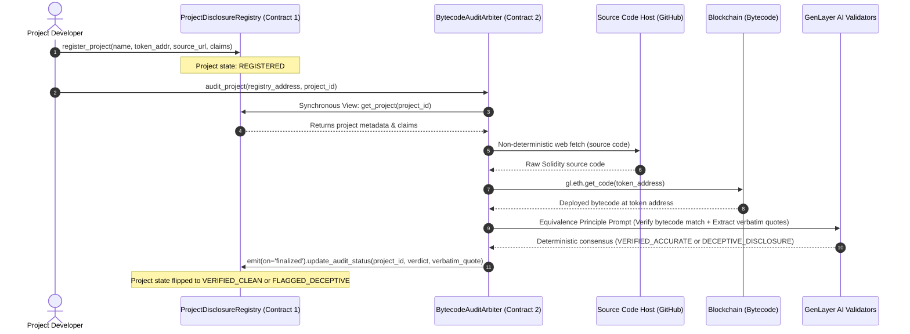

# AuditDual: Two-Contract Source Verifier & Autonomous Disclosure Arbiter

> **GenLayer Builder Track**: Intelligent Contracts (Target: 150 Points)  
> **Mechanism Shape**: Two contracts whose interaction **IS** the mechanism (Contract 2 consumes Contract 1's finalized state and triggers state callbacks on finality).  
> **Network**: GenLayer StudioNet (Chain ID: `61999`)  
> **Runtime**: `py-genlayer` (Python Intelligent Contracts)

---

## 1. Overview & Architectural Shape

`AuditDual` is a two-contract decentralized auditing architecture deployed on GenLayer StudioNet. It autonomously verifies whether a smart contract's actual Solidity source code honors its public disclosure claims (e.g., fixed supply, absence of hidden owner minting backdoors, or arbitrary blacklist mechanisms).

Instead of relying on centralized security seals or off-chain audit reports, `AuditDual` implements an on-chain, two-contract state machine:
1. **Contract 1 (`ProjectDisclosureRegistry`)**: Stores projects, developers' declared claims, and on-chain audit statuses. Only an authorized arbiter contract can mutate the verification state via cross-contract callbacks.
2. **Contract 2 (`BytecodeAuditArbiter`)**: Consumes Contract 1's finalized state via synchronous view calls (`gl.get_contract_at(addr).view()`), fetches external Solidity code non-deterministically via `gl.nondet.web.get()`, and adjudicates claim fidelity through the Equivalence Principle (`gl.eq_principle.prompt_non_comparative`). Upon consensus finalization, it asynchronously triggers a state transition on Contract 1 via `target.emit(on='finalized').update_audit_status(...)`.



---

## 2. On-Chain Deployments & Verified StudioNet Contracts

| Contract | Address | StudioNet Explorer |
| :--- | :--- | :--- |
| **ProjectDisclosureRegistry** (Contract 1) | `0xBC6d84D6398dae57b1f5070E59a3487607E27e9B` | [View on Explorer](https://explorer-studio.genlayer.com/address/0xBC6d84D6398dae57b1f5070E59a3487607E27e9B) |
| **BytecodeAuditArbiter** (Contract 2) | `0x34366d699922a0862e55381C0b7c3879d2b9effB` | [View on Explorer](https://explorer-studio.genlayer.com/address/0x34366d699922a0862e55381C0b7c3879d2b9effB) |

---

## 3. On-Chain Finalized Execution Manifest

All transactions below were executed and reached finality on StudioNet:

| Step | Contract | Method | Tx Hash | Result & Consensus State |
| :---: | :--- | :--- | :--- | :--- |
| **1** | `ProjectDisclosureRegistry` | `deploy` | [`0xd1fb7563...`](https://explorer-studio.genlayer.com/tx/0xd1fb7563062ff8b399403d59b7b2200b6a1d4b6ecd59d7195b41351754f7d461) | **FINALIZED** (Contract 1 deployed) |
| **2** | `BytecodeAuditArbiter` | `deploy` | [`0x0c0ddd65...`](https://explorer-studio.genlayer.com/tx/0x0c0ddd6540c65569d83204320a71bcb3d9cfd60cce43b594b516d3148e071941) | **FINALIZED** (Contract 2 deployed) |
| **3** | `ProjectDisclosureRegistry` | `set_authorized_arbiter` | [`0x4fe477c5...`](https://explorer-studio.genlayer.com/tx/0x4fe477c5f70e7401ed7d81ceb94b652efaed474252d494c36bd4933e8aafa202) | **FINALIZED** (Bound Arbiter address) |
| **4** | `ProjectDisclosureRegistry` | `register_project` | [`0xe40dff00...`](https://explorer-studio.genlayer.com/tx/0xe40dff0034fccf1afc36817a10129667e7243dbd1d86ab89ccb7fea902dc151a) | **FINALIZED** (Project 0: `HonestToken` registered) |
| **5** | `ProjectDisclosureRegistry` | `register_project` | [`0x9b6bbdda...`](https://explorer-studio.genlayer.com/tx/0x9b6bbdda756e95148bb5b0ba79f8c32de9ce1cee87b8873804b83c5557399055) | **FINALIZED** (Project 1: `DeceptiveToken` registered) |
| **6** | `BytecodeAuditArbiter` | `audit_project` (Proj 0) | [`0xe7feae7ac...`](https://explorer-studio.genlayer.com/tx/0xe7feae7ac11406cdefeef6daae0c3aead3572f3bf6d34e7edb715be03d401d71) | **FINALIZED**: `VERIFIED_ACCURATE`<br>Quote: `totalSupply = 1_000_000 * 10**18;`<br>Cross-contract callback flipped C1 to `VERIFIED_CLEAN` |
| **7** | `BytecodeAuditArbiter` | `audit_project` (Proj 1) | [`0x0bf175f6...`](https://explorer-studio.genlayer.com/tx/0x0bf175f6d0044d26762360f4d2ef9ac8dfde6d60955becf64828a8ddc1a2e921) | **FINALIZED**: `DECEPTIVE_DISCLOSURE`<br>**Adversarial Honeypot Caught**<br>Quote: `function mint(address to, uint256 amount) public onlyOwner returns (bool) {`<br>Cross-contract callback flipped C1 to `FLAGGED_DECEPTIVE` |

Full transaction parameters and read-back states are documented in [`deploy/proof.json`](file:///C:/Users/user/Desktop/audit_dual/deploy/proof.json).

---

## 4. Key Mechanism Safeguards

1. **Model Judges, Code Moves State**: AI validators in GenLayer evaluate whether raw source lines contradict declared claims and extract exact verbatim quotes. The resulting JSON decision is parsed deterministically, and the state transition on Contract 1 is strictly enforced via permissioned callbacks.
2. **Strict Verbatim Quoting Rule**: Any finding of deception must cite an exact substring from the fetched source file. If the quote cannot be verified verbatim against the raw source, the arbiter fails closed to `UNCERTAIN` rather than making an unverified state change.
3. **Bytecode Correspondence Verification**: Before auditing claims, the arbiter fetches the deployed bytecode at the registered token address via `gl.eth.get_code()` and requires AI validators to confirm the fetched source code corresponds to the deployed bytecode. This prevents an attacker from registering a malicious contract but providing a clean source URL.
4. **Equivalence Principle Isolation**: Prompts use `gl.eq_principle.prompt_non_comparative`. All variables passed into `get_input` closures are cloned locally beforehand, preventing closure serialization errors.
5. **Deterministic Clamping & Sanitization**: Max source code length clamped to 32,000 characters; claims clamped to 500 characters; reason messages clamped to 280 characters to prevent gas exhaustion and memory denial of service.

---

## 5. Local Testing & Verification

Unit tests test contract methods, state transitions, verbatim quote validation, and cross-contract dispatch mocking:

```bash
# Clone the repository
git clone https://github.com/Kosaiyno/audit-dual.git
cd audit-dual

# Run test suite
uv run python -m unittest discover -s tests
```

Output:
```
.......
----------------------------------------------------------------------
Ran 7 tests in 0.002s

OK
```

---

## 6. Honest Limitations

- **Gas / Payload Clamping**: Source code inputs are clamped at 32 KB. Massive multi-contract repositories require flattened single-file contracts or modular library auditing.
- **Static vs. Dynamic Semantics**: The Equivalence Principle evaluates semantic adherence of function definitions and state variable mutations, but does not execute formal symbolic verification or EVM fuzzing.
- **Bytecode Verification Heuristic**: The current implementation uses AI validators to assess bytecode correspondence rather than on-chain compilation. Full bytecode-to-source hash equivalence would require a Solidity compiler in the execution environment.
